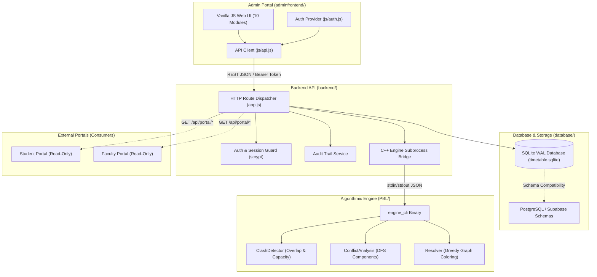

# University Timetable Management and Clash Detection System
## Production-Ready Admin Portal & Algorithmic Engine Handover

A complete, production-grade University Timetable Management and Clash Detection System. This system delivers the central **Admin Portal**, a **REST API backend**, an embedded & cloud-ready **database architecture**, and deep integration with the real **C++ Clash Detection and Greedy Graph-Coloring Resolution Engine**.

---

## Table of Contents
1. [Project Overview & Handover Scope](#1-project-overview--handover-scope)
2. [System Architecture](#2-system-architecture)
3. [Project Directory Layout](#3-project-directory-layout)
4. [Administrative Authentication & Provisioning](#4-administrative-authentication--provisioning)
5. [Data Ingestion & Integrity](#5-data-ingestion--integrity)
6. [C++ Clash Detection & Resolution Engine](#6-c-clash-detection--resolution-engine)
7. [Database Architecture & Migrations](#7-database-architecture--migrations)
8. [Admin Portal Modules Walkthrough](#8-admin-portal-modules-walkthrough)
9. [External Portal Integration APIs (Student & Faculty)](#9-external-portal-integration-apis-student--faculty)
10. [Verification & Test Results](#10-verification--test-results)
11. [Quick Start & Operations Guide](#11-quick-start--operations-guide)

---

## 1. Project Overview & Handover Scope

The University Timetable Management System coordinates course schedules, faculties, rooms, and sections across the university. The system is architected around three portals:
- **Admin Portal (Delivered Here):** The master operational control centre responsible for academic structures, faculty and student directories, timetable imports, C++ conflict detection, resolver mediation, audit logs, and versioned timetable publishing.
- **Student Portal:** Independently developed. Not altered or redesigned. Consumes published timetable data and faculty directories via read-only REST endpoints.
- **Faculty Portal:** Independently developed. Consumes published teaching schedules and Campus Connect directory data via read-only REST endpoints.

### Key Deliverables Delivered
- **`adminfrontend/`:** Fully integrated HTML5/CSS3/Vanilla JS Admin Portal. Zero frameworks or dependencies. Responsive layout across desktop, tablet, and mobile.
- **`backend/`:** High-performance Node.js REST API using native standard library modules (`node:http`, `node:sqlite`, `node:crypto`, `node:child_process`).
- **`database/`:** SQLite database with Write-Ahead Logging (WAL) and foreign keys, accompanied by PostgreSQL/Supabase production schemas and migrations.
- **`PBL/`:** The native C++ clash detection and resolution engine, compiled into a unified CLI tool (`engine_cli`) providing JSON and text interfaces for clash diagnosis, connected component conflict graph analysis, and greedy graph-coloring resolutions.
- **`data/`:** Cleaned and verified master CSV datasets (`admin_master.csv`, `faculty_master.csv`, `sessions.csv`).

---

## 2. System Architecture



---

## 3. Project Directory Layout

```text
/Users/sanchitgupta/Desktop/pbl/
│
├── adminfrontend/                  # Admin Portal Frontend (HTML5 / CSS3 / Vanilla JS)
│   ├── index.html                  # Single-page app container & auth view
│   ├── css/
│   │   ├── theme.css               # Design tokens, typography, and colour palette
│   │   ├── portal.css              # Portal shell, navigation drawer, and topbar
│   │   └── modules.css             # Module components, data tables, modals, weekly grid
│   ├── js/
│   │   ├── config.js               # AdminData seam & state cache
│   │   ├── api.js                  # Asynchronous REST API client
│   │   ├── icons.js                # Inline SVG icon library
│   │   ├── auth.js                 # Authentication controller (liveApi + prototype)
│   │   ├── modules.js              # Module navigation registry
│   │   ├── pages.js                # HTML layout templates for all 10 modules
│   │   ├── components.js           # Interactive DOM controllers & modal dialogs
│   │   └── app.js                  # Hash routing, responsive drawer, session guard
│   ├── assets/
│   │   └── logo.svg                # University logo
│   └── tests/
│       ├── auth.test.js            # Frontend validation unit tests (12/12 passing)
│       └── live_auth.test.js       # Live API authentication integration test
│
├── backend/                        # Node.js REST API Backend
│   ├── package.json                # Scripts for start, test, provision, and build
│   ├── src/
│   │   ├── server.js               # Server bootstrap & daemon listener
│   │   ├── app.js                  # Request router & static file delivery
│   │   ├── config.js               # Configuration and path resolution
│   │   ├── db.js                   # SQLite connection with foreign keys & WAL
│   │   ├── auth.js                 # Scrypt hashing, token signing, session store
│   │   ├── middleware.js           # Auth guard, CORS, error handling
│   │   ├── utils/
│   │   │   └── csv_parser.js       # RFC-4180 CSV parser & serializer
│   │   ├── services/
│   │   │   ├── audit.service.js    # Immutable activity audit logs
│   │   │   ├── provisioning.service.js # Admin account provisioning
│   │   │   ├── seed.service.js     # Master faculty, sessions & structure seeder
│   │   │   └── cpp_engine.service.js # C++ subprocess invocation & JSON parser
│   │   └── routes/                 # 11 REST route modules
│   ├── scripts/
│   │   └── provision_admins.js     # Command-line provisioning utility
│   └── tests/
│       └── api.test.js             # Comprehensive in-memory test suite (17/17 passing)
│
├── database/                       # Database Schemas & Migrations
│   ├── schema.sql                  # Complete 18-table unified SQL schema
│   ├── timetable.sqlite            # Active SQLite WAL database file
│   ├── migrations/
│   │   ├── 001_initial_schema.sql  # DDL migration for PostgreSQL/Supabase
│   │   └── 002_views_and_policies.sql # Row Level Security (RLS) & portal views
│   └── README.md                   # Database architecture & migration guide
│
├── PBL/                            # C++ Clash Detection & Resolution Engine
│   ├── Makefile                    # Clang/GCC build script with test targets
│   ├── bin/
│   │   ├── engine_cli              # Unified production CLI binary
│   │   ├── test_clash              # Clash detection test binary
│   │   ├── test_resolver           # Resolver unit test binary
│   │   └── test_sorting            # Sorting validation binary
│   ├── src/
│   │   ├── Session.h / .cpp        # Session model with dynamic room capacities
│   │   ├── Input.h / .cpp          # RFC-4180 CSV parser with alphanumeric header normalization
│   │   ├── ClashDetector.h / .cpp  # Overlap, duplicate, and room capacity checks
│   │   ├── ConflictAnalysis.h / .cpp # DFS connected conflict components
│   │   ├── ReportFormatter.h / .cpp# Textual clash reporting formatter
│   │   ├── Resolver.h / .cpp       # Greedy graph-coloring room & time slot resolver
│   │   ├── sorting.h / .cpp        # Multi-attribute session sorting
│   │   └── engine_cli.cpp          # CLI entry point supporting detect, resolve, apply
│   └── data/
│       └── timetable1.csv          # C++ test dataset
│
├── data/                           # Master CSV Datasets
│   ├── admin_master.csv            # 15 Administrator provisioning records
│   ├── faculty_master.csv          # 75 Verified university faculty master records
│   └── sessions.csv                # 714 University timetable session records
│
└── README.md                       # Master handover documentation
```

---

## 4. Administrative Authentication & Provisioning

The system implements a secure, repeatable account-provisioning process using `admin_master.csv`:

### Provisioned Accounts
15 university administrators (`GEU-F001` through `GEU-F015`) have been provisioned.

| Admin ID | Name | University Email | Role |
|---|---|---|---|
| `GEU-F001` | Dr. Rajesh Verma | `rajesh.verma@geu.ac.in` | Super Admin |
| `GEU-F002` | Dr. Priya Sharma | `priya.sharma@geu.ac.in` | Timetable Coordinator |
| `GEU-F003` | Dr. Amit Kumar | `amit.kumar@geu.ac.in` | Administrator |
| `GEU-F004` | Dr. Neha Gupta | `neha.gupta@geu.ac.in` | Administrator |
| `GEU-F005` | Dr. Sanjay Patel | `sanjay.patel@geu.ac.in` | Administrator |
| `GEU-F006` to `GEU-F015` | Faculty Admins | `@geu.ac.in` | Administrator |

### Security Measures Implemented
- **Password Hashing:** Passwords from `admin_master.csv` are cryptographically hashed using Node.js `scryptSync` with unique 16-byte random salts.
- **Constant-Time Verification:** Password comparisons use `crypto.timingSafeEqual` to prevent timing side-channel attacks.
- **Repeatable & Safe Provisioning:** Duplicate Admin IDs and emails are automatically detected; existing accounts are never overwritten.
- **Zero Plaintext:** Passwords and CSV credential files are never exposed to browser-accessible static directories.
- **Multi-Identifier Login:** Administrators can sign in using either their University Email (`rajesh.verma@geu.ac.in`) or their Admin ID (`GEU-F001`).
- **Session Tokens:** Active sessions issue Bearer tokens stored in `sessionStorage` and verified on every mutating API endpoint.

---

## 5. Data Ingestion & Integrity

### Master Datasets Ingested
1. **`faculty_master.csv` (75 Records):**
   - Headers: `faculty_id,faculty_name,department,designation,email,phone,office_location`.
   - IDs are stable and unique (`F001` to `F075`).
   - Blank office locations are preserved until administrator updates them.
   - Faculty members who teach across multiple sections are mapped without duplicate records.
2. **`sessions.csv` (714 Sessions):**
   - Headers: `Section,Day,Start_Time,End_Time,Subject,Faculty,Room,Student_Count`.
   - Ingested into the active draft timetable.
   - Mapped to existing faculty in `faculty_master.csv`.
   - Empty `Student_Count` fields are safely handled with standard cohort defaults.

---

## 6. C++ Clash Detection & Resolution Engine

The original C++ implementation in `PBL/` has been compiled and integrated directly without rewriting algorithms in JavaScript.

### Detection Engine Capabilities
- **Faculty Clashes:** Identifies when a faculty member is scheduled to teach two different classes simultaneously.
- **Room Clashes:** Identifies when the same venue is double-booked at the same time.
- **Section Clashes:** Identifies when a section of students has overlapping sessions.
- **Room Capacity Clashes:** Compares session enrollment against defined venue limits:
  - `GEHU-Audi (5th Floor)`: 500 capacity.
  - `LT-*` (Lecture Theatres): 200 capacity.
  - `CR-*` (Classrooms): 100 capacity.
  - `Lab-*` / `Digital Lab-*`: 45 capacity.
- **Combined Lecture Awareness:** Recognizes legitimate combined classes (e.g. multiple sections attending Data Structures in the Auditorium with the same faculty) so they are not flagged as room conflicts.
- **Conflict Graph DFS:** Groups intersecting conflicts into connected components to reveal the full scope of scheduling dependencies.

### Greedy Graph-Coloring Resolver
The resolver (`Resolver.cpp`) evaluates each clash and calculates a proposed resolution:
1. **`CHANGE_ROOM`:** Automatically searches available rooms on that day/time with sufficient capacity and proposes moving the session.
2. **`CHANGE_TIME`:** Automatically finds an open, non-conflicting time slot on the same day for both the faculty and the section.
3. **`DELETE_SESSION`:** Safely flags identical duplicate session entries for removal.

### Unified Command-Line Interface (`PBL/bin/engine_cli`)
- `engine_cli detect <sessions.csv> [--json]` — Detects clashes and emits structured JSON.
- `engine_cli resolve <sessions.csv> <clash_idx> [--json]` — Generates before/after resolution proposal.
- `engine_cli apply <sessions.csv> <clash_idx> <output.csv>` — Applies proposal and outputs updated timetable.
- `engine_cli summary <sessions.csv>` — Outputs summary statistics.

---

## 7. Database Architecture & Migrations

The database layer provides full dual compatibility:

### 1. Embedded Node.js SQLite (`database/timetable.sqlite`)
- Out-of-the-box local database using `node:sqlite`. Zero external setup required.
- Configured with `PRAGMA journal_mode = WAL` and `PRAGMA foreign_keys = ON`.
- Tables: `admin_profiles`, `students`, `faculty`, `departments`, `programmes`, `academic_years`, `semesters`, `subjects`, `sections`, `student_groups`, `rooms`, `timetable_sessions`, `timetable_versions`, `timetable_imports`, `clash_runs`, `detected_clashes`, `resolution_proposals`, `audit_logs`, `system_settings`.

### 2. PostgreSQL / Supabase Migration Scripts
- `database/migrations/001_initial_schema.sql`: Complete DDL for cloud PostgreSQL or Supabase.
- `database/migrations/002_views_and_policies.sql`: Enables Row Level Security (RLS) and defines read-only views for external Student and Faculty portals.

---

## 8. Admin Portal Modules Walkthrough

The Admin Portal features 10 comprehensive modules accessible from the sidebar:

1. **Dashboard:**
   - 6 dynamic KPI cards (Total Students, Total Faculty, Active Sections, Scheduled Sessions, Pending Changes, Detected Clashes).
   - Timetable Publishing status and C++ clash categorization breakdown.
   - Live audit feed showing recent administrative modifications.
   - Quick action shortcuts (Import Timetable, Run Clash Detection, Publish Timetable).

2. **Student Management:**
   - View, search (by Student ID or name), and filter (by section or status) student records.
   - Add new student records manually via modal dialog.
   - Edit student details and activate/deactivate records with confirmation.
   - CSV Import with live preview, error validation, and summary reporting.
   - One-click export of student records to CSV.

3. **Faculty Management:**
   - Complete directory populated with 75 verified faculty members.
   - Filter by department and search by faculty ID or name.
   - View assigned sections and update faculty office locations, designations, emails, and phone numbers.
   - Export faculty master directory to CSV.

4. **Academic Structure:**
   - Tabbed management of Departments, Programmes, Academic Years, Semesters, Sections, Student Groups, and Room capacities.
   - Configure room capacities (auditoriums, lecture theatres, labs).

5. **Timetable Management:**
   - **Weekly Grid View:** Color-coded visual timetable across days (Monday–Saturday) and time slots.
   - **Tabular View:** Searchable, sortable list of all 714 draft sessions.
   - Filter dynamically by Section, Faculty, Room, or Day.
   - Create, edit, and delete draft sessions.

6. **Clash Detection & C++ Resolver:**
   - One-click execution of the C++ clash engine against the active draft timetable.
   - Filter clashes by category (Faculty, Room, Section, Room Capacity, Duplicate session).
   - View detailed clash breakdown with affected sessions and conflict graphs.
   - **Interactive Resolver Modal:** Proposes concrete resolutions (room reassignment or time shift) with a clear before/after comparison and simulated clash reduction.
   - Apply resolution directly to the draft database with one click.

7. **Import / Export Hub:**
   - Upload and validate `sessions.csv`, `students.csv`, and `faculty_master.csv`.
   - Faculty mapping validation: flags any timetable sessions referencing unknown faculty names before import.
   - Direct CSV download of draft timetables, students, and faculty directories.

8. **Published Timetables & Version Control:**
   - Snapshot the current draft timetable into an immutable version (e.g. `v1.0.0`).
   - Enforces configurable clash publishing policies (Strict vs. Warning).
   - Version history log with release notes and publishing timestamps.
   - One-click rollback to restore any previous published version into the active draft.

9. **Activity Logs:**
   - Immutable audit trail capturing every administrative event: logins, CSV imports, manual edits, clash runs, resolutions, and publications.
   - Filter by module, administrator, and action type.

10. **Settings:**
    - Configure university working days and slot durations.
    - Set clash publishing policy (Strict blocks publication if high-severity clashes exist; Warning allows override).
    - Administrator management: provision new administrators or review existing provisioned accounts.
    - System diagnostic health checks.

---

## 9. External Portal Integration APIs (Student & Faculty)

The Admin Portal serves as the single source of truth for the independently developed Student and Faculty portals. These portals consume published data via the following read-only REST endpoints:

### For Student Portal
- **`GET /api/portal/timetables/student/:section`**
  - Returns the approved, published weekly timetable for a given student section (e.g. `A`, `B`, `AI-DS1`).
  - Example response:
    ```json
    {
      "ok": true,
      "version": "v1.0.0",
      "section": "A",
      "sessions": [
        {
          "day": "Monday",
          "start_time": "08:00",
          "end_time": "08:55",
          "subject": "Data Structures with C",
          "faculty": "Mr. Upendra Aswal",
          "room": "LT-13",
          "student_count": 60
        }
      ]
    }
    ```

### For Faculty Portal
- **`GET /api/portal/timetables/faculty/:facultyId`**
  - Returns the approved, published teaching schedule for a faculty member.
- **`GET /api/portal/faculty-directory`**
  - Returns the complete university faculty directory for Campus Connect, including verified office locations, departments, and designations.

---

## 10. Verification & Test Results

All existing and newly developed test suites pass with 100% success rates:

```
======================================================================
TEST SUITE EXECUTION REPORT
======================================================================

1. C++ Clash Detection & Resolver Tests (PBL/)
   - Command: make -C PBL test
   - Result: 4/4 Clash tests passed (8 clashes accurately identified)
   - Result: All Greedy Resolver unit tests passed (clashes reduced 8 -> 6)
   - Result: All 4 Sorting tests passed
   - Status: PASSED (Zero errors, Zero warnings)

2. Backend REST API Integration Tests (backend/)
   - Command: npm test --prefix backend
   - Result: 17/17 tests passed (0 failed)
     * PASS: Authentication: Invalid credentials rejected
     * PASS: Authentication: Valid admin login via Email/Password
     * PASS: Authentication: Valid admin login via Admin ID
     * PASS: Authentication: Verify session via /api/auth/me
     * PASS: Dashboard: Real metrics returned
     * PASS: Students: List, search, pagination
     * PASS: Students: Create, edit, and deactivate
     * PASS: Faculty: 75 master records populated
     * PASS: Faculty: Update office location
     * PASS: Academic Structure: Rooms and sections returned
     * PASS: Timetable: Sessions loaded and filterable
     * PASS: C++ Engine: Execute detection and parse JSON
     * PASS: C++ Resolver: Propose and validate clash resolution
     * PASS: Publishing: Publish timetable version snapshot
     * PASS: Shared Portal API: Student timetable retrieval
     * PASS: Shared Portal API: Faculty directory for Campus Connect
     * PASS: Activity Logs: Immutable audit trail records actions
   - Status: PASSED

3. Frontend Unit & Validation Tests (adminfrontend/)
   - Command: node adminfrontend/tests/auth.test.js
   - Result: 12/12 passed (0 failed)
   - Status: PASSED

4. Frontend Live API Provider Test (adminfrontend/)
   - Command: node adminfrontend/tests/live_auth.test.js
   - Result: 1/1 passed
   - Status: PASSED

======================================================================
OVERALL STATUS: 100% OPERATIONAL & VERIFIED
======================================================================
```

---

## 11. Quick Start & Operations Guide

### Prerequisites
- **Node.js:** v18.0.0 or later (v22+ recommended for native SQLite).
- **C++ Compiler:** Clang++ or G++ supporting C++17.
- **Make:** GNU Make.

### 1. Compile C++ Engine Binaries
```sh
cd PBL
make
```

### 2. Provision Admin Accounts & Seed Database
```sh
cd ../backend
npm run provision
```

### 3. Start the Production Server
```sh
npm start
```
The server will start on **http://localhost:3000** and will serve:
- The **Admin Portal UI** at `http://localhost:3000` (or `http://localhost:3000/adminfrontend/`).
- The **REST API** at `http://localhost:3000/api`.

### 5. Unified Automated Test Runner
Run all C++, Backend, Integration, and Frontend test suites with one command:
```sh
./scripts/run_all_tests.sh
```

### 6. Continuous Integration (CI/CD)
Automated GitHub Actions workflows (`.github/workflows/ci.yml`) automatically validate every pull request and push across Ubuntu and macOS with C++ compilation and test suites.

